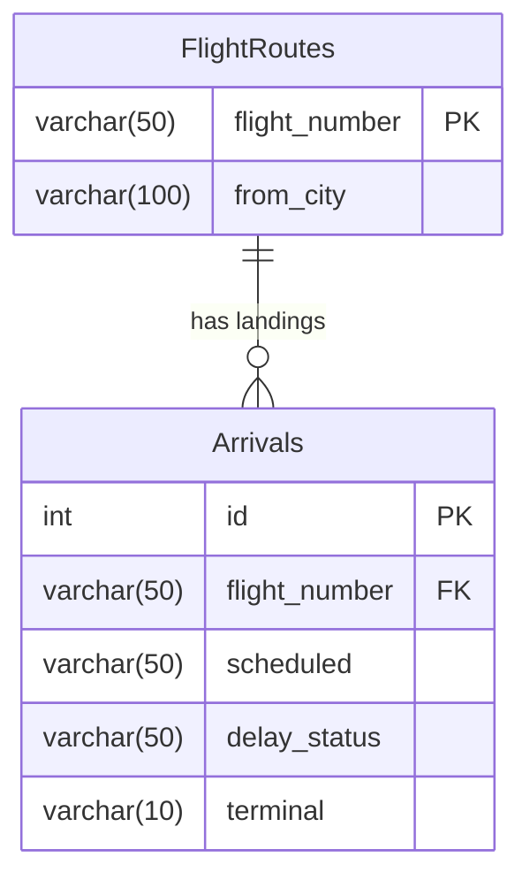

# Flight Arrivals Management System (`JDBC_FlightManager`)

**Course:** Software Engineering Methods (Academic Year 2026–2027)  
**Institution:** Braude College of Engineering | Department of Software Engineering  
**Database Engine:** MySQL 8.0+ | **Language:** Java 25 LTS (JDBC)

---

## 1. Project Description
This project implements the Data Access Layer (DAL) of an airport flight arrivals management system in Java (JDBC) over a local MySQL database (`FlightDB`).

The workflow covered:
* **CSV ingestion:** 299 raw landing records from `arrived_flights.csv` were imported into a flat staging table, `rawflights`.
* **3NF normalization:** The flat table was decomposed, with AI assistance, into two normalized tables, `FlightRoutes` and `Arrivals`, linked by a foreign key.
* **JDBC operations:**
  * `FlightManagerBase` reconstructs the full arrivals board with an `INNER JOIN`.
  * `SimpleFlightUpdater` updates a single flight's status.
  * `AdvancedFlightDispatcher` updates several arrivals in one round trip with a batched `PreparedStatement` (`addBatch` / `executeBatch`).
  * `FlightViewer` filters arrivals by terminal and sorts them by scheduled time with a parameterized query.
* **Security audit:** A live SQL Injection attack was executed against the original `Statement`-based updater, which overwrote all 299 rows. The class was then refactored into a secure `PreparedStatement` and documented with Javadoc.

All database resources (`Connection`, `Statement` / `PreparedStatement`, `ResultSet`) are managed with try-with-resources, and the MySQL password is entered at runtime rather than stored in source code.

---

## 2. Engineering Team Details (Single-Workstation Driver–Navigator)

| Role | Full Name | Student ID | Braude Academic Email |
| :--- | :--- | :--- | :--- |
| **Student A** | `Eden krainits` | `211589742` | `eden.krainits@e.braude.ac.il` |
| **Student B** | `Joe abou ghannam` | `322470998` | `joe.abou.ghannam@e.braude.ac.il` |


* **GitHub Repository URL:** `https://github.com/EdenKrayniz/JDBC_FlightManager`

---

## 3. Technology Stack
* **Runtime & JDK:** BellSoft Liberica Full JDK 25 LTS
* **Database Server:** MySQL Server 8.0+ (`FlightDB` schema), tested on MySQL Community Server 26.10
* **JDBC Driver:** MySQL Connector/J 9.5.0 (`mysql-connector-j-9.5.0.jar`)
* **IDE & Database Tooling:** IntelliJ IDEA Ultimate (Built-in Database Console & SQL Generator)
* **AI Assistant:** GitHub Copilot (IntelliJ plugin, Ask mode), used in place of the suggested LM Studio (`Qwen2.5-Coder-7B-Instruct`) + Continue setup
* **Version Control:** Git & GitHub

---

## 4. Database Normalization (3NF) & Functional Dependencies ($F$)

### 4.1 Functional Dependencies ($F$) in `rawflights`
The staging table `rawflights(scheduled, flight, fromC, delay, terminal)` stores one row per landing event. The functional dependency identified is:

$$F = \{\ \text{flight} \rightarrow \text{fromC}\ \}$$

A flight number uniquely determines its departure city. The same flight can land on multiple dates and schedules, so `flight` alone does not identify a landing row and is not a key of `rawflights`.

**Verification:** Before migrating, we confirmed that the dependency holds in the data with the following query, which returned 0 rows:

```sql
SELECT flight, COUNT(DISTINCT fromC) AS cities
FROM rawflights
GROUP BY flight
HAVING COUNT(DISTINCT fromC) > 1;
```

### 4.2 Why `rawflights` Violated 3NF
3NF requires that for every non-trivial functional dependency $X \rightarrow A$, either $X$ is a superkey or $A$ is a prime attribute. In `flight → fromC`, `flight` is not a superkey and `fromC` is not part of any key. The departure city is therefore stored redundantly in every landing row of the same flight, which causes three anomalies:

* **Update anomaly:** Renaming a departure city requires updating every landing row of that flight. Missing one row leaves the data inconsistent.
* **Insertion anomaly:** A new route (flight number and departure city) cannot be recorded until a first landing exists.
* **Deletion anomaly:** Deleting the landing history of a flight also deletes the only record of which city the route departs from.

**Note:** In the current dataset each flight number appears only once, so `FlightRoutes` also contains 299 rows. The decomposition is justified by the dependency itself rather than by the current data: as soon as a flight lands again, the flat table would repeat the city, while the normalized schema only adds a row to `Arrivals`.

### 4.3 Decomposed 3NF Relational Schema

**`FlightRoutes`** (parent table: one row per route)

| Column | Type | Constraint |
| :--- | :--- | :--- |
| `flight_number` | `VARCHAR(50)` | **PRIMARY KEY** |
| `from_city` | `VARCHAR(100)` | `NOT NULL` |

**`Arrivals`** (child table: one row per landing event)

| Column | Type | Constraint |
| :--- | :--- | :--- |
| `id` | `INT` | **PRIMARY KEY**, `AUTO_INCREMENT` |
| `flight_number` | `VARCHAR(50)` | `NOT NULL`, **FOREIGN KEY** → `FlightRoutes(flight_number)` `ON DELETE CASCADE` |
| `scheduled` | `VARCHAR(50)` | |
| `delay_status` | `VARCHAR(50)` | |
| `terminal` | `VARCHAR(10)` | |

Because of `ON DELETE CASCADE`, deleting a route automatically deletes its landings. Deleting landings never deletes the route. For the same reason, `Arrivals` must be dropped before `FlightRoutes` when resetting the schema.

**Design note:** `scheduled` is stored as `VARCHAR(50)` to simplify CSV ingestion. Since all times are zero-padded (`HH:MM:SS`), `ORDER BY scheduled ASC` produces correct chronological order. A production system would use `TIME` or `DATETIME`.

---

## 5. Independent AI Prompt (Part 4 – `FlightViewer.java`)

```text
Write a complete Java class named FlightViewer with a main method.

Prompt the user via Scanner for the MySQL root password and connect to the FlightDB database using DriverManager with URL: "jdbc:mysql://localhost:3306/FlightDB?allowLoadLocalInfile=true&allowPublicKeyRetrieval=true&serverTimezone=Asia/Jerusalem&useSSL=false" and user "root".

Then prompt the user to enter a target terminal number (valid terminals in the dataset are 2, 3, 4, 5).

Use try-with-resources for the Connection, the PreparedStatement and the ResultSet.

Use a secure PreparedStatement with a '?' placeholder to run this query:
SELECT a.id, a.flight_number, r.from_city, a.scheduled, a.delay_status, a.terminal
FROM Arrivals a
INNER JOIN FlightRoutes r ON a.flight_number = r.flight_number
WHERE a.terminal = ?
ORDER BY a.scheduled ASC

Bind the parameter using pstmt.setString(1, terminal), because the terminal column is VARCHAR(10).

Print the results as a formatted table with aligned columns (ID, Flight, From, Scheduled, Status, Terminal), and print the total number of flights found at the end. If no flights are found, print a clear message.

Catch SQLException and print a clear error message instead of a stack trace.
```

---

## 6. Entity Relationship Diagram (ERD)



---

## 7. Security Audit Summary (Part 5 – SQL Injection Mitigation)
* **Attack Payload Tested:** `Landed' #`
* **Vulnerability Analysis (`Statement`):** The original `SimpleFlightUpdater` built the query by concatenating raw user input:
  `"UPDATE Arrivals SET delay_status = '" + userInput + "' WHERE flight_number = 'LX354'"`.
  With the payload, the database received:
  `UPDATE Arrivals SET delay_status = 'Landed' #' WHERE flight_number = 'LX354'`.
  The single quote closed the string literal early, and `#` started a MySQL single-line comment, so the entire `WHERE` clause was ignored. `executeUpdate()` reported **299 affected rows instead of 1**, and every arrival's status was overwritten to `Landed`.
* **Remediation (`PreparedStatement`):** The class was refactored to use `"UPDATE Arrivals SET delay_status = ? WHERE flight_number = ?"` with `setString(...)`. The SQL template is sent to the server and pre-compiled before any user data is bound, so its structure (a single `UPDATE` with a `WHERE` clause) is fixed. Bound values are transmitted separately and treated strictly as data, never parsed as SQL. Re-running the same payload updated **exactly 1 row** (`LX354`), storing the literal text `Landed' #`, while the remaining 298 rows were untouched.

---

## 8. License
Distributed under the **Braude College Academic License** (Software Engineering Methods, 2026–2027).
